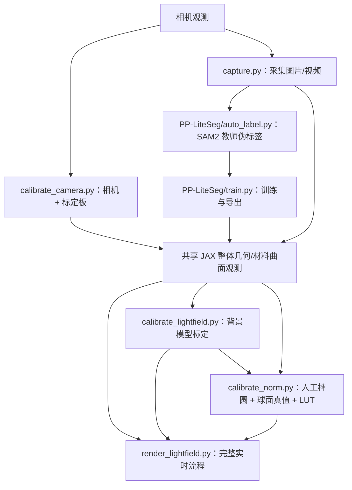

# 仓库结构与方法主链路

核对日期：2026-10-11。本文以当前源码、`config.yaml` 和入口注册为依据，供后续精简、方法确认与可读性改进使用。`surface_reconstruction/` 按要求排除在方法审查之外，仅记录它与现有仓库的边界。

本文区分四种关系：**主链核心**直接参与当前重建；**上游准备**产生主链所需数据或模型；**替代分支**实现另一种背景方法；**辅助/独立模块**用于预览、诊断、测试或独立功能。没有进入每帧推理不等于可以删除。

## 1. 已确认的主链路

当前仓库实现的是柔性视触觉传感器的两层重建：先由曲面左右轮廓重建整体弯曲，再由相机颜色相对无局部形变背景的差异恢复局部法向位移。

```text
相机/视频/单图 BGR
  → PP-LiteSeg 分割 + 最大外轮廓/填洞
  → 左右侧边提取、去畸变、单调配对
  → 整体共享 Y/Z 曲线与直纹面
  → 固定物理尺寸的材料曲面归一化，生成 XYZ / UV / ST
  → direct_fit_s：原始几何 → encoder + GRU → s 仿射 warp + 外观状态 → 背景
  → 加上启动阶段拟合并冻结的低频会话修正 Bsession
  → 相机线性 RGB − 预测背景 = 有符号色差
  → 按 UV 在高分辨率观测网格上采样
  → 法向 LUT：色差 → 局部坡度 (p,q) 与置信度
  → 曲率感知的加权最小二乘 → 法向位移 d
  → 最终曲面 Xout = Xbase + d·nbase
```

当前默认选择为 `lightfield.background.method: direct_fit_s`，分割后端为 `liteseg`，局部重建开启，实时线性求解器为 `spectral_pcg`。`direct_fit_3` 和 `physical_residual` 仍有实现，但不属于主配置的默认背景路径。

**真正的完整流程调度器是 `render_lightfield.py:main()`。** `recon.py:main()` 转发到这个函数；`recon.py` 同时承担法向 LUT、局部重建数据结构和离线 CPU 求解职责。不能仅凭文件名把 `recon.py` 当成完整实时实现，或把 `render_lightfield.py` 当成单纯的渲染工具。

## 2. 入口与职责

入口注册见 [pyproject.toml](pyproject.toml) 的 `[project.scripts]`。

| 使用入口 | 实际执行函数 | 在方法中的职责 |
|---|---|---|
| `uv run recon.py` / `uv run render-lightfield` | `recon.main()` → `render_lightfield.main()`；后者直接调用同一函数 | 完整整体几何、背景、色差和局部形变流程；支持相机、`--video`、`--image` |
| `uv run get-surface` | `get_surface.main()` | 只运行分割与整体材料曲面重建，可显示点云、保存叠加图及 UV–XYZ 映射 |
| `uv run calibrate-camera` | `calibrate_camera.main()` | 相机内参与畸变标定，支持棋盘格/圆点阵及异常样本剔除 |
| `uv run calibrate-lightfield` | `calibrate_lightfield.main()` | 生成共享几何观测，训练所选背景方法，保存背景模型及评估结果 |
| `uv run calibrate-norm` | `calibrate_norm.main()` | 人工椭圆选区、标定球坡度真值、会话背景拟合、法向 LUT 生成 |
| `uv run recon-local` | `recon.local_main()` | 对已导出的 NPZ 进行离线 CPU 局部求解，不运行分割或背景模型 |
| `uv run capture` | `capture.main()` | 固定相机设置，采集图像和录像；默认目录录像使用 FFV1 AVI |
| `uv run sam2-preview` | `sam2_preview.main()` | SAM2 提示点和视频分割的独立预览 |
| `bash PP-LiteSeg/run_pipeline.sh` | `auto_label.py` → `train.py` | 分割模型准备：伪标签、训练、导出；已有有效数据集时可跳过标注 |
| `uv run python PP-LiteSeg/realtime.py` | `realtime.main()` | PP-LiteSeg 的独立分割预览，不进行三维或局部重建 |

`manual_norm_regions.py` 没有独立 CLI；它是 `calibrate_norm.py` 使用的人工标注组件。项目没有注册名为 `recon` 的控制台命令，完整重建使用 `recon.py` 或 `render-lightfield`。

## 3. 上游准备与产物依赖



这里表示数据/产物依赖；相机标定与分割模型训练之间没有严格先后顺序。已有可用产物时可直接复用。

### 3.1 相机标定与采集

- [capture.py](capture.py) 通过 `utils.camera.open_camera()` 固定曝光、白平衡及可选分辨率，保存供分割、背景或法向标定使用的观测。
- [calibrate_camera.py](calibrate_camera.py) 使用 OpenCV 标定内参与畸变，按单帧重投影 RMS、median/MAD 和配置上限剔除异常样本，输出相机标定 YAML。
- 相机内参由 `utils.config.load_camera_calibration()` 读取。实时 JAX 路径要求 OpenCV 五参数畸变模型。
- 相机内参标定与重建首帧的 `R/tx` 求解是两件不同的事：前者是离线准备，后者属于每次重建会话初始化。

### 3.2 分割模型准备

```text
采集视频 + config.yaml 中的 SAM2 提示点
  → utils.sam2_surface.SurfaceSegmenter
  → PP-LiteSeg/auto_label.py：教师 mask、伪标签、manifest
  → PP-LiteSeg/train.py：训练/验证划分、PaddleSeg 训练、推理模型导出
  → assets/surface_t1/inference_model/
  → utils.liteseg_surface.PaddleSegPredictor：主链推理
```

教师 SAM2 会逐帧推进视频记忆，`sample_fps` 控制保存监督样本的频率。`train.py` 通过 `common.split_samples_by_video()` 优先按视频分组划分数据，只有一个视频时使用其时间尾段验证，并导出部署模型。当前运行时解析器明确拒绝 `mode: sam2`：SAM2 不是完整重建的可切换在线分割后端。

### 3.3 背景标定：当前 `direct_fit_s`

[calibrate_lightfield.py](calibrate_lightfield.py) 负责输入、观测缓存、失败诊断及方法分派；[utils/direct_fit_s.py](utils/direct_fit_s.py) 负责时序背景模型训练及误差诊断。

1. 显式区分 `trusted_flat_videos`、`sequence_videos` 和可选的 `validation_sequence_videos`。主配置分别使用 `trusted_flat.avi`、`flat_bend_flat.avi`、`val.avi`。
2. `extract_video_frames()` 无损导出抽取帧；`reconstruct_all_observations()` 使用与实时一致的 PP-LiteSeg 后处理和 JAX 材料重建链，保存 `xyz/uv/st/depth`、归一化前的 `raw_observed_xyz`、序列身份及质量信息。
3. 将实测线性 RGB 采样到规范观测网格。可信平直帧通过逐像素 Huber 聚合得到静态底色纹理 `B`，并以原始三维弧长中位数建立满长测量基准。
4. 从训练几何合成裁剪序列，监督可见区间；随后用真实弯曲序列对齐冻结的 `B`，学习几何 encoder、GRU 和 warp。
5. 建立带有效域 mask 的外观 PCA；在完整序列上拟合外观状态，并在 GRU hidden 空间建立训练状态系数残差的近邻记忆。
6. 最后冻结 encoder、GRU、warp 和 appearance，只训练共享颜色 trunk 与三个 RGB head。按启动时固定的训练监控批次选取最小颜色 RMSE 的参数。
7. 完整留出视频用于最终前向评估，不参与上述模型训练或颜色 checkpoint 选择；默认时序方法不使用旧模式的逐帧随机留出。
8. 保存 `LightFieldModel` YAML 和 `.metrics.yaml`。`--diagnostics-only` 可加载已有 `direct_fit_s` 模型进行独立验证诊断，另写 `.diagnostics.yaml`。

观测缓存依赖源文件和重建配置指纹；材料状态具有时序依赖。只有完整的成功/失败账本一致时才整体跳过重建，部分缺失时会重放输入序列。

### 3.4 法向 LUT 标定

[calibrate_norm.py](calibrate_norm.py) 复用 `calibrate_lightfield.reconstruct_all_observations()`，再执行两遍背景/色差计算：

1. 第一遍使用离线背景生成色差，读取已有人工椭圆，或通过 `manual_norm_regions.edit_manual_ellipse()` 编辑缺失标注。
2. 人工椭圆是接触区的唯一来源；将其膨胀后从会话背景拟合样本中排除，在其余区域拟合本次标定会话的 `Bsession`。
3. 第二遍使用会话背景计算有符号色差；椭圆向内缩小后作为 LUT 采样域，人工跳过的图像不进入 LUT。
4. 将像素映射到重建平面的毫米坐标，结合已知球半径生成球面坡度真值。例如相对球心的平面坐标为 `(ξ,η)` 时，坡度为 `(-ξ,-η)/sqrt(R²-ξ²-η²)`。
5. `build_normal_lut()` 建立 `64×64×64×2` 坡度表，按样本数和法向角 RMS 筛选原始节点，利用邻近有效节点填补缺失节点，保存方差、原始有效域、样本数和颜色范围。
6. 将零色差三线性查询涉及的节点固定为零坡度；保存格式版本 4 的有符号 LUT，并绑定背景方法、背景文件哈希、材料模板哈希与重建语义。

当前主配置：球半径 `6 mm`，至少人工选用 `5` 张图，每节点至少 `5` 个样本，节点法向角 RMS 上限 `5°`。核对这些设置不代表已验证实物采集的准确性。

法向标定中的 `direct_fit_s` 在两遍处理中分别从零 hidden 开始，按观测顺序推进；几何观测也被组织为 `normal_calibration_images` 序列。图片顺序与时序状态有关，不能把它视为完全无状态的逐图 LUT 标定。

## 4. 完整实时链的逐阶段实现

### 4.1 配置、模型与会话初始化

`render_lightfield.main()` 读取配置、构造分割器和 `EdgeReconstructor`、选择 JAX 设备、加载 `LightFieldModel`；开启局部重建时再加载 `NormalCalibration`。

`utils.config.load_config()` 支持顶层 `extends` 和递归映射合并。模型路径可按背景方法分派，也兼容单一路径字段。核心检查包括：

- 背景模型的方法、材料模板哈希、B 样条控制网格尺寸，以及 direct 方法的弯曲方向语义；物理分支额外检查灯带布局。
- LUT 的背景方法、背景文件 SHA-256、残差方法、材料模板哈希和重建管线版本。direct 方法要求 LUT 记录背景方法及模型哈希。

材料模板由宽度、长度、网格和端点方向确定性生成，并绑定相机与重建配置指纹。当前不需要独立模板采集文件。修改相机标定、材料尺寸或几何语义后，原模型/LUT 可能不再兼容。

### 4.2 分割与 mask 后处理

实际调用为：

```text
SurfaceSegmentationBackend.segment_tensors(frame)
  → utils.liteseg_surface.PaddleSegPredictor.predict(frame)
  → label == foreground_class 的 mask
  → refine_masks_numpy()
  → utils.surface_mask.refine_mask()
  → 上传 JAX
```

`refine_mask()` 只保留最大外轮廓并填洞，不修正圆角或物理端点。实时、背景标定、法向标定与教师标签共用这套后处理语义。当前材料重建明确要求一个连续曲面 label。

主配置分割每 `2` 帧更新一次；中间帧复用 mask 和整体几何，当前相机颜色仍逐帧读取。

### 4.3 整体几何：轮廓到原始曲面

主要实现为 `utils.jax_reconstruction`，首帧外参优化来自 `utils.process.EdgeReconstructor.process_curves()`。

1. `prepare_edge_curves_from_masks_jax()` 取每行最左/最右包络，排除上下各 `2%` 侧边样本，去畸变并重采样。左右边不依赖图像横向封口边。
2. 首个可用帧将边缘曲线交给 CPU/SciPy，交替执行联合非线性优化和单调匹配，求出 `R/tx` 以及初始共享曲线；外参初始化成功后锁定。
3. 后续 JAX 路径利用已知的左右侧平面 `X=−W/2` 与 `X=+W/2`，动态规划单调配对，再通过二阶平滑的线性最小二乘求共享 `Y/Z` 曲线。
4. 每个截面内沿 X 线性补点，得到整体直纹面；同时生成三维点投影和左右边界 UV 修正。

整体基础模型可写成：

```text
Xbase(i,j) = [x(j), y(i), z(i)]
```

它能表达纵向弯曲，截面内部沿 X 方向保持直线；当前这层整体几何不能表达任意横向弯曲或扭转。

### 4.4 材料曲面归一化与状态提交

`reconstruct_material_surface_with_diagnostics_from_masks_jax()` 接收原始曲面观测，沿弧长重采样方向场，将其归一到配置的固定材料段长，重建 `MaterialSurfaceState`。

- `raw_observed_xyz` 保留归一化前的曲线长度和几何信息，供 `direct_fit_s` 测长先验及 encoder 使用。
- 归一化 `xyz` 使用名义宽度/全长；主配置为 `22×55 mm`，纵向每段长度固定。
- 更新时 `bend_direction: increasing` 通过保序投影约束段方向的弯曲趋势。
- UV 由三维投影加实测左右轮廓的平滑边界修正得到；UV 修正用于图像采样，不改变 XYZ。
- `_select_material_surface_candidate_jax()` 分别返回 `tracking_accepted` 和 `calibration_accepted`：有限数、正深度、合法状态、观测与光栅容量等结构条件决定是否提交追踪；RMS/confidence 额外决定是否允许写入标定数据。低置信度或较高 RMS 本身不再回滚安全的追踪候选。
- 结构失败时保留上一材料状态。实时 `direct_fit_s` 仅在追踪候选提交时推进 GRU，失败时保留 hidden 和上次原始几何。

**这一层将当前可见轮廓归一到完整模板区间，并不识别真实物理端边，也不恢复被遮挡段的材料身份。** 背景网络预测的 s-warp 是颜色坐标对齐，不能当作完整三维遮挡重建。

### 4.5 几何重采样、光栅化与可见域

`resample_material_surface_jax()` 将整体材料状态重采样到光场网格与观测网格。`rasterize_attributes_jax()` 将 ST 和相机深度光栅化到原始图像，得到图像像素到规范坐标的对应及前表面深度。

有效域由曲面投影、分割 mask 和深度一致性共同确定；观测点与前表面深度差不得超过配置的 `1 mm`。光栅器有固定三角形包围盒容量，超出容量会被检查，不能视为无限容量的通用渲染器。

### 4.6 `direct_fit_s` 背景预测

核心函数在 `utils.lightfield`：

| 函数 | 作用 |
|---|---|
| `direct_geometry_conditions_jax()` | 从归一化前几何取得 encoder latent 和标准化几何 PCA 条件 |
| `direct_s_recurrent_step_jax()` | 输入几何 latent 和测长可见比例先验，推进 GRU hidden |
| `direct_s_interval_from_logits_jax()` | 由两个 logit 修正可见长度并分配 s 两端缺失量 |
| `direct_s_warp_coordinates_jax()` | 只对 s 做仿射变换，t 保持不变 |
| `direct_s_normalized_appearance_scores_jax()` | 从 hidden 预测外观系数，按开关叠加训练状态近邻记忆 |
| `direct_s_background_rgb_with_scores_jax()` | 融合坐标、全局/局部几何、hidden 和外观系数，求值颜色网络 |
| `direct_s_background_field_jax()` | 将背景展开为规范纹理，随整体几何更新缓存 |

令区间预测为 `(a,v,b)`，满足 `a+v+b=1`，则：

```text
s' = a + v·s
t' = t
```

warp 作用于静态 B 采样和坐标 Fourier 编码。低秩外观场在观测坐标 `(s,t)` 上采样；局部几何特征也在观测坐标上取得。不要把所有分支统称为“warp 后纹理”。

共享 trunk 加三个标量 head 输出 logit 空间的颜色修正 δ。背景可概括为：

```text
B0(s,t) = clip(Bstatic(s',t) + Appearance(hidden; s,t), ε, 1−ε)
F(s,t)  = sigmoid(logit(B0(s,t)) + δθ(s',t,global,local,hidden,scores))
```

因此当前实现并非简单的线性 `B + 神经 deltaB` 相加。训练中使用 RGB，**稳态背景预测的网络输入不包括当前相机 RGB**；`direct_fit_s` 固定 `gain=1、bias=0`，避免逐帧光度拟合改变背景。

### 4.7 启动会话修正

相机/录像模式会先等待连续稳定窗口，再采集无接触帧，通过 `fit_startup_direct_bsession_model()` 拟合低频加性样条修正，并冻结到本次会话结束。

主配置要求 `5` 帧稳定窗口，随后采集 `15` 帧会话修正数据。稳定性主要检查规范残差场时间变化和有效域重叠；direct 方法的 gain/bias 范围仅作为诊断。

当前 direct 模型的 `residual_b_coefficients` 表示低频会话修正的离线零先验，静态高分辨率 B 另存在 `direct_base_texture`；二者虽然都使用 B 命名，但不是同一种字段。

单图 `--image` 分支不能建立会话修正或启动无接触统计，直接使用离线模型，`direct_fit_s` 从零 hidden 前进一步。这一分支用于单图诊断，和经过历史状态及启动标定后的实时结果不等价。

### 4.8 有符号色差与 LUT 输入

`reconstruct_and_render_gpu_impl()` 将 BGR 转成线性 RGB，把规范背景和会话修正映射回原始图像：

```text
Ibg(p) = clip(F(ST(p)) + Bsession(ST(p)), 0, 1)
ΔC(p)  = Vdiff(p) · [Icamera_linear(p) − Ibg(p)]
```

`Vdiff` 是向内腐蚀后的有效域，主配置腐蚀 `6 px`。色差保留正负；生产 LUT 输入不取绝对值，也不把变暗通道裁为零。

随后 `sample_linear_rgb_jax()` 按观测网格 UV 从全分辨率色差图双线性采样。不是先将相机图片缩小到观测网格，也不是直接使用屏幕显示用的伪彩色差图。

`oracle_uniform_difference` 是历史配置名称；当前只显示所选残差方法产生的同一份净化色差。direct 方法没有逐帧 M 分数拟合，`residual_method: uniform_huber` 主要用于方法元数据一致性及公共会话处理；物理分支才逐帧求 `[Bsession,M]` 系数。

### 4.9 坡度、可信无接触与曲率感知积分

`lookup_slopes_jax()` 三线性查询法向 LUT，得到局部坡度向量和基于方差的置信度。主配置还启用两组保护：

- 零色差保护：以线性色差 `max(abs(R),abs(G),abs(B))` 度量，`≤0.08` 强制零坡度，`0.08～0.15` 平滑放开，外侧保留 LUT 坡度。
- 可信无接触：从启动帧建立每个观测位置的残差中心及 RGB 鲁棒尺度；低响应且不在强响应保护邻域/边缘排除域的点设为零坡度，并增加软 `d=0` 数据项。它不将统计 mask 外的所有位移硬置零。

`utils.jax_local_reconstruction.reconstruct_local_surface_jax()` 从基础曲面计算切向框架、度量、参考法向与曲率，求解法向位移。用 `r=(p,q)` 表示 LUT 坡度，目标可概括为：

```text
min_d Σij areaij·confidenceij · ||γij·dij + Kij·∇h dij − rij||²
      + λ0·Σtrusted areaij·dij²
约束：有效域边界 d=0，并增加四个奇偶子格的离散 Dirichlet 闭合方程。
```

`K` 将参数梯度映射到局部切向坡度，`γ` 表示基础曲率与观测坡度带来的修正。这里的 K 与相机内参矩阵不是同一符号含义。

实时求解先比较频域 Poisson 初值和上一帧位移的当前目标残差，再选择较好的初值，使用矩阵自由谱预条件 PCG 精修。主配置为 `2` 轮频域初值、容差 `1e-4`、最多 `50` 次精修。上一帧位移只是数值热启动，不是时序正则项。

最终 `Xout=Xbase+d·nbase`，d 的单位为毫米。Open3D 中的 `deformation_geometry_gain` 只改变显示几何；保存数据仍使用真实位移。

## 5. 数据契约、网格与更新频率

### 5.1 五个网格

| 配置项 | 当前 rows×columns | 含义 |
|---|---:|---|
| `geometry_grid` | `120×52` | 左右边配对、整体共享曲线和基础几何；列包含两侧边界 |
| `lightfield_grid` | `120×52` | 从整体几何重采样，用于光场与图像光栅化 |
| `observation_grid` | `400×202` | 规范 RGB 观测、会话拟合样本、局部形变未知量与显示几何 |
| `residual_coefficient_grid` | `128×64` | Bsession / 物理 B、M 的三次样条控制系数；不是 XYZ 顶点 |
| `residual_texture_grid` | `400×202` | 规范背景/修正纹理展开后供图像采样；不是额外三维网格 |

尺寸相同不表示用途相同。尤其 `geometry_grid` 控制昂贵的边缘配对成本，`observation_grid` 控制局部位移问题规模。

### 5.2 关键数据

| 数据/类型 | 形状或含义 | 生产者 → 消费者 |
|---|---|---|
| `mask` | 一个连续曲面的 `H×W bool`，统一接口为 `1×H×W` | PP-LiteSeg → 边缘、有效域 |
| `raw_observed_xyz` | 归一化前规则几何，保留原始长度 | 整体轮廓重建 → direct_fit_s 测长、encoder/GRU |
| `MaterialSurfaceTemplate` | 尺寸、ST、固定段长、横向坐标与哈希 | 配置 → 所有几何/模型一致性检查 |
| `MaterialSurfaceState` | 当前曲线、XYZ、UV、深度、可见性、边界修正与质量 | JAX 材料重建 → 背景、观测网格、下一次状态更新 |
| `ReconstructionPointSet` | 带 XYZ/UV/ST、边缘标记与截面索引的逐点映射 | 几何 → 保存、离线观测、整体显示 |
| `LightFieldModel` | 所选方法参数、纹理/样条及材料元数据 | 背景标定 → 在线背景、法向标定 |
| `NormalCalibration` | `64³×2` 坡度 LUT、方差、范围、方法与哈希 | 法向标定 → 在线/离线局部求解 |
| `color_residual_grid` | 与观测 XYZ 同形的线性有符号 RGB | 全分辨率色差按 UV 采样 → LUT |
| `LocalReconstructionResult` | 最终 XYZ、标量/向量位移、法向、坡度、置信度和求解诊断 | 局部求解 → 显示、NPZ 保存 |

### 5.3 帧间更新

| 阶段 | 当前更新规则 |
|---|---|
| PP-LiteSeg、整体材料曲面、direct_fit_s hidden/背景纹理 | 每 `2` 帧；追踪失败时保留上一状态 |
| 相机颜色、有符号色差、UV 颜色采样、局部位移 | 每帧；启动会话标定完成后进入稳态局部求解 |
| Open3D 网格上传 | 每 `2` 帧，数值局部求解仍每帧执行 |
| `R/tx` | 每会话首次初始化成功后锁定 |
| Bsession / 无接触统计 | 启动时拟合一次并冻结 |

背景标定的 `direct_fit_s_video_frame_step: 2` 与实时分割间隔一致，GRU 的时间步对应有效几何更新，不是每个原始相机帧。

## 6. 模块清单

### 6.1 根目录与目录级结构

| 路径 | 归属 | 当前责任 |
|---|---|---|
| [recon.py](recon.py) | 主链核心 + 离线辅助 | 实时入口转发、LUT/结果数据类、无接触统计、CPU LUT/局部 LSMR、`recon-local` |
| [render_lightfield.py](render_lightfield.py) | 主链核心 | 完整实时调度、初始化、几何/背景缓存、启动会话拟合、逐帧色差/局部求解、显示与单图输出 |
| [get_surface.py](get_surface.py) | 主链几何入口 + 共享帮助函数 | 单独运行整体重建；提示/mask 配置解析、点集转换及 UV–XYZ 文件写出被其他入口复用 |
| [calibrate_lightfield.py](calibrate_lightfield.py) | 上游准备 | 三种背景方法的共同入口、序列抽帧、共享观测生成、缓存、失败诊断、训练/评估分派 |
| [calibrate_norm.py](calibrate_norm.py) | 上游准备 | 人工接触选区、标定会话修正、球面坡度、LUT 与验证图 |
| [manual_norm_regions.py](manual_norm_regions.py) | 法向准备的必要组件 | 人工椭圆数据、持久化、mask 与编辑器 |
| [calibrate_camera.py](calibrate_camera.py) | 上游准备 | 相机内参/畸变标定及异常视图剔除 |
| [capture.py](capture.py) | 上游准备 | 图像/视频采集，独立 CLI |
| [sam2_preview.py](sam2_preview.py) | 辅助预览 | SAM2 提示与 mask 预览，不参与重建推理 |
| [config.yaml](config.yaml) | 主链配置 | 相机、采集、分割、材料、五网格、法向、direct 背景、会话和局部求解参数 |
| [config_physical_residual.yaml](config_physical_residual.yaml) | 替代分支配置 | 继承主配置，覆盖物理背景、灯带/扩散/BM 参数和模型/LUT 路径 |
| `configs/ablations/` | 方法消融 | direct_fit_s 无历史、无外观记忆、无局部几何三种配置 |
| `utils/` | 主链、上游和替代方法的公共实现 | 详见下一表 |
| `PP-LiteSeg/` | 上游训练 + 独立分割预览 | 自建伪标签/训练/导出脚本，非整套 PaddleSeg 源码副本 |
| `tests/` | 验证辅助 | 现有主链及外围模块测试；不被生产入口调用 |
| `docs/` | 方法说明与历史实验 | 需要结合第 8 节的偏差阅读 |
| `assets/` | 本地输入与生成产物 | 相机标定、模型、LUT、视频、训练检查点、缓存、映射、诊断；被 `.gitignore` 排除 |
| [pyproject.toml](pyproject.toml)、[uv.lock](uv.lock)、[.python-version](.python-version) | 环境/打包 | 依赖、入口、锁文件；项目要求 Python ≥3.10，本地版本文件为 3.12 |
| `.venv/`、`__pycache__/`、`.pytest_cache/`、`recon.egg-info/` | 环境/生成缓存 | 不属于方法源码 |
| `surface_reconstruction/` | 新增独立模块，本次排除 | 无现有主入口集成关系，保持独立记录 |

### 6.2 `utils/` 全量模块

| 模块 | 归属 | 核心责任与边界 |
|---|---|---|
| [utils/camera.py](utils/camera.py) | 主链/采集公共组件 | `open_camera()`：固定相机曝光、白平衡和尺寸 |
| [utils/config.py](utils/config.py) | 主链/标定公共组件 | YAML 继承、方法选择、路径分派、相机与材料/网格参数解析及哈希 |
| [utils/surface_mask.py](utils/surface_mask.py) | 主链/教师公共组件 | 提示与后处理类型、最大外轮廓填洞 |
| [utils/surface_segmentation.py](utils/surface_segmentation.py) | 主链核心 | 只允许 PP-LiteSeg 的运行时配置、统一接口、NumPy 后处理 |
| [utils/liteseg_surface.py](utils/liteseg_surface.py) | 主链核心 | Paddle 推理器、部署文件定位、预处理、输出 mask |
| [utils/process.py](utils/process.py) | 主链核心 + CPU/显示辅助 | 首帧 CPU 外参优化、边缘/点集数据、CPU 几何工具、Open3D 点云/网格显示 |
| [utils/jax_reconstruction.py](utils/jax_reconstruction.py) | 主链核心 | JAX 边缘、动态规划配对、共享曲线、UV 修正、材料状态归一化与提交、网格重采样 |
| [utils/material_surface.py](utils/material_surface.py) | 主链核心 | 固定尺寸模板、ST 坐标、哈希、JAX 材料状态；不是新增目录 `surface_reconstruction/` |
| [utils/lightfield.py](utils/lightfield.py) | 主链核心 + 替代背景公共实现 | 模型序列化、颜色空间、光栅化、样条、direct_s 推理/记忆、会话拟合；同时包含 direct_3 与物理积分/扩散/BM |
| [utils/direct_fit_s.py](utils/direct_fit_s.py) | 当前默认方法的上游核心 | s-warp、时序外观、记忆与颜色网络训练；含独立验证和 oracle 误差诊断 |
| [utils/gpu_residual_fit.py](utils/gpu_residual_fit.py) | 公共上游 + 替代方法训练 | direct 静态 B 的 Huber 聚合被默认方法复用；其他大块实现用于 direct_3 和物理 B/M 训练，不能整体认定为无关 |
| [utils/jax_local_reconstruction.py](utils/jax_local_reconstruction.py) | 主链核心 | GPU LUT、无接触分类、曲率/微分几何、频域初值、矩阵自由 PCG/LSMR、法向位移 |
| [utils/sam2_surface.py](utils/sam2_surface.py) | 分割上游/预览 | SAM2 视频提示、追踪记忆、Torch 推理；实时重建分割器不调用它 |
| [utils/__init__.py](utils/__init__.py) | 包结构 | `utils` 包标识 |

### 6.3 `PP-LiteSeg/`

| 文件/目录 | 作用 | 与主链关系 |
|---|---|---|
| `auto_label.py` | SAM2 教师生成二分类 surface 标签、预览、样本 manifest | 分割模型准备 |
| `train.py` | 数据划分、生成 PaddleSeg 配置、训练、检查点选择、推理模型导出 | 分割模型准备 |
| `common.py` | 数据/配置、路径、manifest、校验与原子写入 | 上述脚本公共组件 |
| `run_pipeline.sh` | 自动检查现有数据集，执行标注及训练导出 | 工作流包装 |
| `inference.py` | 独立工具使用的 Paddle 推理器 | 与 `utils/liteseg_surface.py` 有相近实现，供训练子项目预览使用 |
| `realtime.py` | 摄像头/视频 mask 叠加与截图 | 独立预览，不进行重建 |
| `config.yaml` | 兼容旧 `--settings` 的平铺配置 | 默认已改读根 `config.yaml` 的 `pp_liteseg` 段 |
| `dataset/` | 图片、伪标签、manifest、预览等本地数据 | 生成产物，不是方法代码 |
| `tests/test_pipeline.py` | 数据、配置和训练脚本测试 | 验证辅助 |

### 6.4 测试与文档

| 范围 | 文件 |
|---|---|
| 相机、采集、配置 | `tests/test_camera.py`、`test_camera_calibration.py`、`test_capture.py`、`test_config_grids.py` |
| 分割和教师/预览 | `tests/test_surface_segmentation.py`、`test_sam2_surface_video.py`、`test_sam2_preview.py`、`PP-LiteSeg/tests/test_pipeline.py` |
| 整体几何、材料、映射 | `tests/test_reconstruction.py`、`test_material_surface.py`、`test_uv_xyz_map.py` |
| 背景模型、标定、实时调度 | `tests/test_lightfield.py`、`test_lightfield_calibration.py`、`test_render_lightfield.py` |
| 法向与局部重建 | `tests/test_norm_calibration.py`、`test_local_reconstruction.py` |
| 综合数学说明 | [docs/recon_math.md](docs/recon_math.md)，有历史描述未同步，不能直接作为当前实现的完整规范 |
| 法向与局部操作说明 | [docs/local_reconstruction.md](docs/local_reconstruction.md)，默认背景、自动接触检测等描述已过时 |
| 历史物理残差/oracle 消融 | [docs/residual_mode_and_oracle_comparison.md](docs/residual_mode_and_oracle_comparison.md)，明确记录历史实验 |
| 颜色误差审查 | [docs/color_error_audit.md](docs/color_error_audit.md)，保留问题分析与当时修正；主要围绕 direct_3，需和当前 direct_s 分开阅读 |

## 7. 不属于当前默认主链的部分

### 7.1 两种替代背景方法

它们共享分割、材料几何、UV 观测、法向 LUT 和局部求解，因此属于方法替代分支，不是完全独立的无关代码。

| 方法 | 背景核心 | 在线光度/残差处理 | 主要实现 |
|---|---|---|---|
| `direct_fit_s`，当前默认 | 原始几何 encoder + GRU + s-warp + 外观 PCA/状态记忆 + trunk/RGB heads | gain=1、bias=0；冻结会话加性修正；不逐帧拟合 M | `utils/direct_fit_s.py`、`utils/lightfield.py` 的 `direct_s_*` |
| `direct_fit_3` | 静态 B + 全局/局部几何条件的三个颜色 decoder；无时序 s-warp | 每帧鲁棒 RGB gain/bias + 冻结低频会话修正；不逐帧拟合 M | `utils/gpu_residual_fit.py:fit_direct_geometry_conditioned_field_gpu()`、`utils/lightfield.py` 的 `direct_background_*` |
| `physical_residual` | 边缘灯带积分、曲面扩散及 RGB 混合；再用经验 B/M 修正 | 每帧 gain/bias、启动 Bsession 与 M 会话重参数化、逐帧 uniform 或 uniform_huber 系数拟合 | `config_physical_residual.yaml`、物理标定分支、`physical_background*()`、`fit_residual_correction_model_gpu()` |

物理模式的 M 表示残差空间模态，当前覆盖配置保留 `20` 个；direct_s 的外观 PCA/hidden 记忆不是同一套 M 系数机制。切换背景方法须使用配套背景模型与重新标定的 LUT。

### 7.2 消融、诊断与独立预览

- `configs/ablations/direct_fit_s_no_history.yaml`：关闭 GRU 的前驱历史输入。
- `configs/ablations/direct_fit_s_no_memory.yaml`：关闭训练状态的外观记忆，另将 appearance 训练步数从主配置的 `100` 改为 `4000`。
- `configs/ablations/direct_fit_s_no_local_geometry.yaml`：将 decoder 的局部几何通道置零。
- `utils.direct_fit_s.diagnose_direct_fit_s_gpu()`、误差 oracle、指标文件与失败叠加图：方法诊断，不是部署时的预测参数来源。
- `sam2_preview.py`、`PP-LiteSeg/realtime.py`：独立检查分割/提示；可单独归档，但不应与分割模型准备链混为一谈。
- `recon-local`：离线 CPU 参考/诊断，使用 SciPy 稀疏 LSMR；没有实时 GRU、启动过程、谱初值或上一帧热启动。
- OpenCV/Open3D 显示、伪彩色差、RMSE 打印和截图：观测/可视化层，原则上可从数值主链解耦。

### 7.3 兼容帮助函数与潜在精简项

以下仅是依据当前仓库调用搜索得到的候选，尚未执行删除：

| 候选 | 当前证据 | 后续处理前需要确认 |
|---|---|---|
| `get_surface.reconstruct_edges()` | 全仓 Python 搜索只发现定义；当前整体入口已走 JAX 材料链 | 是否被仓库外脚本调用，以及是否还需要完整 CPU 边缘构网接口 |
| `utils.jax_reconstruction.prepare_edge_curves()` | 全仓搜索只发现定义；生产使用 `prepare_edge_curves_from_masks_jax()` | 是否保留旧 NumPy 边缘曲线适配 API |
| `utils.lightfield.positive_residual_bgr_jax()` | 全仓搜索只发现定义；生产使用 signed 色差 | 是否仍有外部可视化使用；不要将其误接回 LUT 输入 |
| `utils.lightfield.positive_residual_bgr()` | 仍被已有测试引用，不属于生产 signed 链 | 测试与历史正残差显示接口的保留策略 |
| `sample_unsaturated_mask()` 与 `filter_original_saturation` | 保留兼容路径/测试；当前背景和法向标定均传 `False` | 旧缓存/调用方兼容要求；不能只凭配置注释删除 |
| `PP-LiteSeg/inference.py` 与 `utils/liteseg_surface.py` | 两套相近的部署加载、预处理和推理实现，调用方不同 | 合并后的脚本导入、异常类型和输出对象兼容性 |
| `PP-LiteSeg/config.yaml` | 明确作为旧 `--settings` 兼容入口保留 | 是否仍有使用该独立配置的运行脚本 |

`utils/process.py` 不能整体删除或移出主链：首帧外参标定、点集结构和显示都仍被调用。`utils/gpu_residual_fit.py` 也不能整体归为旧方法，因为默认 direct_s 复用其静态 B 拟合。

### 7.4 `surface_reconstruction/` 的边界

该目录有独立 `run_reconstruction.py`、JSON 配置、requirements、README、标记检测/跟踪/曲面/显示模块、模板数据、测试和 Windows 启动脚本。

现有根入口、`utils` 和打包入口没有导入或注册这个子项目；它使用自己的标记观测与数据约定。本次不展开其算法、不评价其实现、不把它并入现有轮廓与色差主链。`utils/material_surface.py` 属于现有主链，不能因名称相近一并排除。

## 8. 已确认的偏差与后续整理重点

### 8.1 文档、注释与代码不同步

| 位置 | 旧描述或不一致 | 当前代码事实 |
|---|---|---|
| `docs/local_reconstruction.md`、`docs/recon_math.md` | 主配置固定 `direct_fit_3` | 主配置已经是 `direct_fit_s` |
| 上述法向标定说明 | 自动阈值、连通域、圆拟合/RANSAC 决定接触区 | 当前人工椭圆是唯一接触区来源，入口含 `--edit-manual-regions` |
| `docs/recon_math.md` 的入口/限制说明 | 离线标定逐样本 CPU 重建，与实时 JAX 边缘路径存在差异 | 当前两种标定复用 JAX 材料链，CPU 主要用于首帧外参和辅助处理 |
| `docs/local_reconstruction.md` 的旧阈值 | `minimum_accepted_images: 20` | 当前主配置为 `5`，真实采集量与验证仍需另行判断 |
| `config.yaml` 的部分 warmup 注释、`utils/direct_fit_s.py:color_loss()` 注释 | 颜色阶段通过历史帧反向传播以训练 GRU | 当前显式 `stop_gradient` 且 `color_step` 冻结 encoder/GRU/warp/appearance；只训练 trunk/heads |
| `config.yaml` 消融说明 | 数据和训练预算保持一致 | no_memory 覆盖配置将 appearance 步数提升至 `4000`，不能描述为完全同预算 |
| runtime 的 B/M、gain/bias 与 oracle 命名/注释 | 部分文字仍按旧物理/direct_3 路径表述 | direct_s 固定光度、不逐帧拟合 M，oracle 显示复用所选色差 |

以上应在后续文档/命名整理时同步；本次只记录，不修改旧文档或数值实现。

### 8.2 当前工作区资产状态

在本次检查时，以下资产存在：相机 YAML、PP-LiteSeg 导出模型、三段配置视频、`lightfield_direct_fit_s_model.yaml` 及其 metrics/diagnostics。

但主配置和局部重建配置引用的 `assets/normal_calibration/normal_lut_direct_fit_s.npz` **不存在**；法向资产目录里看到的是 `normal_lut_direct_fit_3.npz`。当前主配置开启局部重建，因此不能仅凭背景模型存在就认定完整默认流程已经具备可运行资产，也不能直接用 direct_3 LUT 替代。

`assets/material_surface_template.npz` 仍留在本地，但当前主链模板由配置生成，源码中未发现对这个具体模板文件的读取。它是待确认用途的历史产物，不是当前方法必需输入。

本节只检查文件存在性，没有读取大型背景 YAML 的全部内容来验证其参数/哈希，也没有执行相机、GPU 实时重建或重新标定。

### 8.3 精简与可读性工作的边界

建议后续优先按责任拆分，而非先按文件大小删除：

1. 将 `render_lightfield.main()` 的配置校验、几何状态、背景方法、启动流程、逐帧数值和显示/输出分别形成清楚接口；它目前在一个大函数里承担全部调度。
2. 将 `recon.py` 的 LUT/结果类型、CPU 参考求解和 CLI 入口分开，避免入口文件互相导入数据/帮助函数。
3. 从 `get_surface.py` 和 `calibrate_lightfield.py` 提取真正共享的配置/观测生成组件，减少“一个入口导入另一个入口”的耦合。
4. 将 `utils.lightfield.py` 中的模型存储、颜色/光栅化、direct_s、direct_3、物理光场和会话残差按职责隔开；明确静态 B、会话 Bsession、物理 B/M 和外观 PCA 的不同含义。
5. 合并重复的 PP-LiteSeg 推理实现，保留现有脚本的兼容边界；将 Torch/SAM2 教师、Paddle 推理和 JAX 数值依赖与各自用途对应。
6. 修正第 8.1 节的历史说明，并对第 7.3 节候选做外部使用和测试引用确认，再决定删除或归档。

## 9. 核对方式与范围

- 检查根目录入口注册、所有现有主项目 Python 模块、配置/消融、文档和测试引用；对 `surface_reconstruction/` 仅做边界确认。
- 按源码实际调用核对实时、背景标定、法向标定和离线局部求解的数据流，尤其检查当前默认方法、时序状态、人工选区、有符号 RGB 和材料状态提交语义。
- 对主项目及 PP-LiteSeg 的 `44` 个 Python 文件进行了 AST 解析；这验证源码可解析及结构索引，不等于硬件/模型运行验证。
- 使用本地 `.venv/bin/python`，设置 `JAX_PLATFORM_NAME=cpu`、`XLA_PYTHON_CLIENT_PREALLOCATE=false`，运行现有 `test_config_grids`、`test_surface_segmentation`、`test_norm_calibration`，`test_lightfield` 中 4 项 direct_fit_s 模型/warp 检查，以及 `test_material_surface` 的 8 项测试。共 **50 项，全部通过**。未新增测试或安装依赖。
- 测试期间 JAX 的 CUDA 插件报告初始化兼容性错误，CPU 测试仍正常通过；本次结果不能用来证明 GPU 环境或实时吞吐可用。
- 本次新增本文档，不删除模块、不调整配置、不重训模型，不变更 `surface_reconstruction/`。
